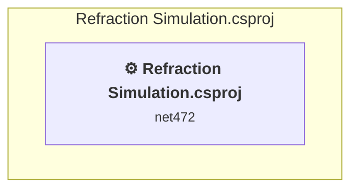

# Projects and dependencies analysis

This document provides a comprehensive overview of the projects and their dependencies in the context of upgrading to .NETCoreApp,Version=v10.0.

## Table of Contents

- [Executive Summary](#executive-Summary)
  - [Highlevel Metrics](#highlevel-metrics)
  - [Projects Compatibility](#projects-compatibility)
  - [Package Compatibility](#package-compatibility)
  - [API Compatibility](#api-compatibility)
  - [Binding Redirect Configuration](#binding-redirect-configuration)
- [Aggregate NuGet packages details](#aggregate-nuget-packages-details)
- [Top API Migration Challenges](#top-api-migration-challenges)
  - [Technologies and Features](#technologies-and-features)
  - [Most Frequent API Issues](#most-frequent-api-issues)
- [Projects Relationship Graph](#projects-relationship-graph)
- [Project Details](#project-details)

  - [Refraction Simulation.csproj](#refraction-simulationcsproj)

## Executive Summary

### Highlevel Metrics

| Metric | Count | Status |
| :--- | :---: | :--- |
| Total Projects | 1 | All require upgrade |
| Total NuGet Packages | 0 | All compatible |
| Total Code Files | 14 |  |
| Total Code Files with Incidents | 14 |  |
| Total Lines of Code | 4455 |  |
| Total Number of Issues | 4514 |  |
| Estimated LOC to modify | 4512+ | at least 101.3% of codebase |

### Projects Compatibility

| Project | Target Framework | Difficulty | Package Issues | API Issues | Binding Issues | Est. LOC Impact | Description |
| :--- | :---: | :---: | :---: | :---: | :---: | :---: | :--- |
| [Refraction Simulation.csproj](#refraction-simulationcsproj) | net472 | 🟡 Medium | 0 | 4512 | 0 | 4512+ | ClassicWinForms, Sdk Style = False |

### Package Compatibility

| Status | Count | Percentage |
| :--- | :---: | :---: |
| ✅ Compatible | 0 | 0.0% |
| ⚠️ Incompatible | 0 | 0.0% |
| 🔄 Upgrade Recommended | 0 | 0.0% |
| ***Total NuGet Packages*** | ***0*** | ***100%*** |

### API Compatibility

| Category | Count | Impact |
| :--- | :---: | :--- |
| 🔴 Binary Incompatible | 3952 | High - Require code changes |
| 🟡 Source Incompatible | 560 | Medium - Needs re-compilation and potential conflicting API error fixing |
| 🔵 Behavioral change | 0 | Low - Behavioral changes that may require testing at runtime |
| ✅ Compatible | 4976 |  |
| ***Total APIs Analyzed*** | ***9488*** |  |

## Aggregate NuGet packages details

| Package | Current Version | Suggested Version | Projects | Description |
| :--- | :---: | :---: | :--- | :--- |

## Top API Migration Challenges

### Technologies and Features

| Technology | Issues | Percentage | Migration Path |
| :--- | :---: | :---: | :--- |
| Windows Forms | 3952 | 87.6% | Windows Forms APIs for building Windows desktop applications with traditional Forms-based UI that are available in .NET on Windows. Enable Windows Desktop support: Option 1 (Recommended): Target net9.0-windows; Option 2: Add <UseWindowsDesktop>true</UseWindowsDesktop>; Option 3 (Legacy): Use Microsoft.NET.Sdk.WindowsDesktop SDK. |
| GDI+ / System.Drawing | 551 | 12.2% | System.Drawing APIs for 2D graphics, imaging, and printing that are available via NuGet package System.Drawing.Common. Note: Not recommended for server scenarios due to Windows dependencies; consider cross-platform alternatives like SkiaSharp or ImageSharp for new code. |
| Legacy Configuration System | 9 | 0.2% | Legacy XML-based configuration system (app.config/web.config) that has been replaced by a more flexible configuration model in .NET Core. The old system was rigid and XML-based. Migrate to Microsoft.Extensions.Configuration with JSON/environment variables; use System.Configuration.ConfigurationManager NuGet package as interim bridge if needed. |

### Most Frequent API Issues

| API | Count | Percentage | Category |
| :--- | :---: | :---: | :--- |
| T:System.Windows.Forms.Label | 358 | 7.9% | Binary Incompatible |
| T:System.Windows.Forms.Button | 244 | 5.4% | Binary Incompatible |
| T:System.Windows.Forms.TableLayoutPanel | 172 | 3.8% | Binary Incompatible |
| T:System.Windows.Forms.Timer | 170 | 3.8% | Binary Incompatible |
| T:System.Windows.Forms.TextBox | 169 | 3.7% | Binary Incompatible |
| T:System.Drawing.Font | 148 | 3.3% | Source Incompatible |
| T:System.Windows.Forms.PictureBox | 100 | 2.2% | Binary Incompatible |
| P:System.Windows.Forms.Control.Font | 96 | 2.1% | Binary Incompatible |
| T:System.Windows.Forms.AnchorStyles | 90 | 2.0% | Binary Incompatible |
| P:System.Windows.Forms.Control.Width | 88 | 2.0% | Binary Incompatible |
| T:System.Windows.Forms.Padding | 80 | 1.8% | Binary Incompatible |
| P:System.Windows.Forms.Control.Size | 75 | 1.7% | Binary Incompatible |
| T:System.Windows.Forms.SizeType | 64 | 1.4% | Binary Incompatible |
| P:System.Windows.Forms.Control.Height | 61 | 1.4% | Binary Incompatible |
| T:System.Windows.Forms.FlowLayoutPanel | 57 | 1.3% | Binary Incompatible |
| P:System.Windows.Forms.Timer.Enabled | 55 | 1.2% | Binary Incompatible |
| P:System.Windows.Forms.Label.Text | 55 | 1.2% | Binary Incompatible |
| P:System.Windows.Forms.Control.ForeColor | 52 | 1.2% | Binary Incompatible |
| P:System.Windows.Forms.Control.Location | 52 | 1.2% | Binary Incompatible |
| P:System.Windows.Forms.Control.Name | 52 | 1.2% | Binary Incompatible |
| T:System.Windows.Forms.ImageLayout | 51 | 1.1% | Binary Incompatible |
| T:System.Windows.Forms.LinkLabel | 46 | 1.0% | Binary Incompatible |
| T:System.Drawing.FontFamily | 44 | 1.0% | Source Incompatible |
| P:System.Drawing.Font.FontFamily | 44 | 1.0% | Source Incompatible |
| M:System.Drawing.Font.#ctor(System.Drawing.FontFamily,System.Single) | 44 | 1.0% | Source Incompatible |
| P:System.Windows.Forms.Control.TabIndex | 43 | 1.0% | Binary Incompatible |
| T:System.Windows.Forms.Keys | 42 | 0.9% | Binary Incompatible |
| M:System.Windows.Forms.Padding.#ctor(System.Int32,System.Int32,System.Int32,System.Int32) | 40 | 0.9% | Binary Incompatible |
| P:System.Windows.Forms.TextBox.Text | 39 | 0.9% | Binary Incompatible |
| T:System.Windows.Forms.FormBorderStyle | 39 | 0.9% | Binary Incompatible |
| P:System.Windows.Forms.ButtonBase.Text | 36 | 0.8% | Binary Incompatible |
| P:System.Windows.Forms.Control.Margin | 31 | 0.7% | Binary Incompatible |
| P:System.Windows.Forms.Form.Opacity | 29 | 0.6% | Binary Incompatible |
| P:System.Windows.Forms.KeyPressEventArgs.KeyChar | 28 | 0.6% | Binary Incompatible |
| F:System.Windows.Forms.SizeType.Percent | 28 | 0.6% | Binary Incompatible |
| T:System.Windows.Forms.TableLayoutControlCollection | 28 | 0.6% | Binary Incompatible |
| P:System.Windows.Forms.TableLayoutPanel.Controls | 28 | 0.6% | Binary Incompatible |
| M:System.Windows.Forms.TableLayoutControlCollection.Add(System.Windows.Forms.Control,System.Int32,System.Int32) | 28 | 0.6% | Binary Incompatible |
| T:System.Windows.Forms.FormWindowState | 27 | 0.6% | Binary Incompatible |
| T:System.Windows.Forms.RowStyle | 26 | 0.6% | Binary Incompatible |
| T:System.Windows.Forms.TableLayoutRowStyleCollection | 26 | 0.6% | Binary Incompatible |
| P:System.Windows.Forms.TableLayoutPanel.RowStyles | 26 | 0.6% | Binary Incompatible |
| M:System.Windows.Forms.TableLayoutRowStyleCollection.Add(System.Windows.Forms.RowStyle) | 26 | 0.6% | Binary Incompatible |
| P:System.Windows.Forms.Timer.Interval | 24 | 0.5% | Binary Incompatible |
| M:System.Windows.Forms.Timer.#ctor(System.ComponentModel.IContainer) | 23 | 0.5% | Binary Incompatible |
| E:System.Windows.Forms.Timer.Tick | 22 | 0.5% | Binary Incompatible |
| P:System.Windows.Forms.Control.Anchor | 22 | 0.5% | Binary Incompatible |
| P:System.Windows.Forms.ButtonBase.BackColor | 21 | 0.5% | Binary Incompatible |
| T:System.Windows.Forms.DockStyle | 21 | 0.5% | Binary Incompatible |
| P:System.Windows.Forms.Control.BackColor | 20 | 0.4% | Binary Incompatible |

## Projects Relationship Graph

Legend:
📦 SDK-style project
⚙️ Classic project

## Project Details

### Refraction Simulation.csproj

#### Project Info

- **Current Target Framework:** net472
- **Proposed Target Framework:** net10.0-windows
- **SDK-style**: False
- **Project Kind:** ClassicWinForms
- **Dependencies**: 0
- **Dependants**: 0
- **Number of Files**: 23
- **Number of Files with Incidents**: 14
- **Lines of Code**: 4455
- **Estimated LOC to modify**: 4512+ (at least 101.3% of the project)

#### Dependency Graph

Legend:
📦 SDK-style project
⚙️ Classic project

### API Compatibility

| Category | Count | Impact |
| :--- | :---: | :--- |
| 🔴 Binary Incompatible | 3952 | High - Require code changes |
| 🟡 Source Incompatible | 560 | Medium - Needs re-compilation and potential conflicting API error fixing |
| 🔵 Behavioral change | 0 | Low - Behavioral changes that may require testing at runtime |
| ✅ Compatible | 4976 |  |
| ***Total APIs Analyzed*** | ***9488*** |  |

#### Project Technologies and Features

| Technology | Issues | Percentage | Migration Path |
| :--- | :---: | :---: | :--- |
| Legacy Configuration System | 9 | 0.2% | Legacy XML-based configuration system (app.config/web.config) that has been replaced by a more flexible configuration model in .NET Core. The old system was rigid and XML-based. Migrate to Microsoft.Extensions.Configuration with JSON/environment variables; use System.Configuration.ConfigurationManager NuGet package as interim bridge if needed. |
| GDI+ / System.Drawing | 551 | 12.2% | System.Drawing APIs for 2D graphics, imaging, and printing that are available via NuGet package System.Drawing.Common. Note: Not recommended for server scenarios due to Windows dependencies; consider cross-platform alternatives like SkiaSharp or ImageSharp for new code. |
| Windows Forms | 3952 | 87.6% | Windows Forms APIs for building Windows desktop applications with traditional Forms-based UI that are available in .NET on Windows. Enable Windows Desktop support: Option 1 (Recommended): Target net9.0-windows; Option 2: Add <UseWindowsDesktop>true</UseWindowsDesktop>; Option 3 (Legacy): Use Microsoft.NET.Sdk.WindowsDesktop SDK. |

